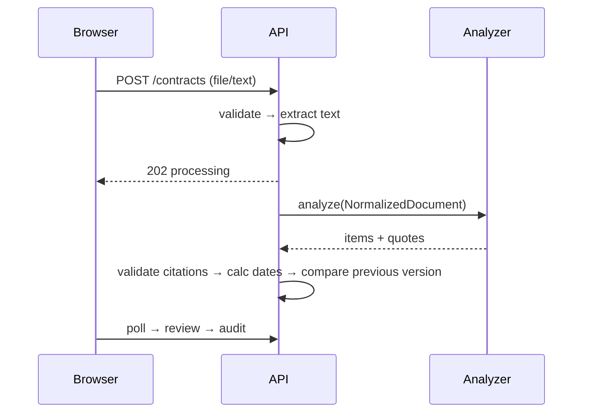

# Architecture
**Frontend**: vanilla SPA, hash routing, all rendering escaped; evidence panel fetches `/api/items/:id/evidence`. **Backend**: Node http, route table, workspace-scoped service layer. **Database**: entities Workspace, User, Contract, ContractVersion (immutable), ExtractedItem (aiValue vs value, state, stale), Citation (embedded, validated), Clarification, AuditEvent; production target: Postgres with FKs and indexes on (workspace_id, contract_id, version_number).

**Date engine**: `calcDeadline({anchor,days,direction})` UTC arithmetic, returns inspectable record. **Citation system**: whitespace/quote-normalized verbatim match → block id, page, section. **Security model**: tenant check in `own()`/workspace filters; 404 on foreign ids.
